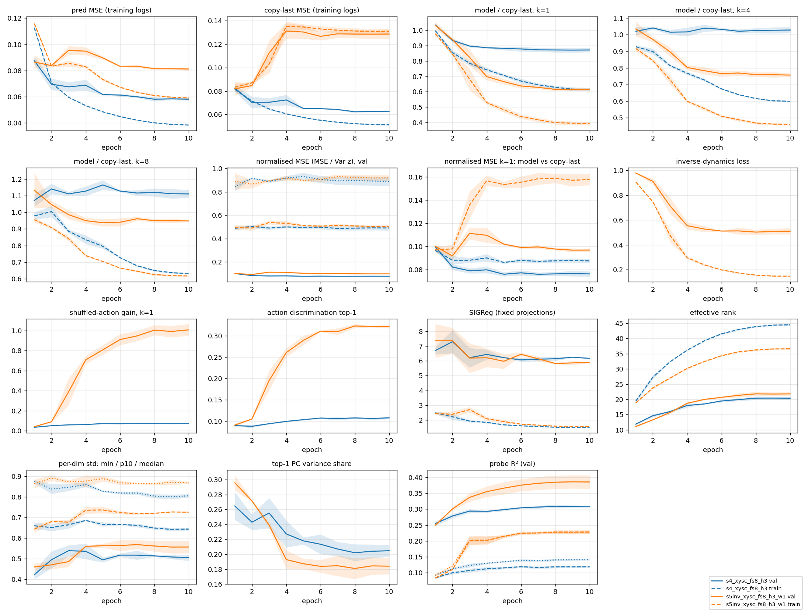

# NavDP feature-prediction loss and navigation results

2026-11-13 报告对应的 yf 实验结果，2026-11-20 整理上传。这里包含本地已有的完整逐 epoch 汇总、曲线、配套评估结果和原报告。**先看下面的收敛口径更正，再阅读历史报告。**

## 结果入口

| 内容 | 文件 |
|---|---|
| Feature MSE、归一化误差、动作依赖性、表示统计等逐 epoch 曲线 | [stage6/stage6_epochs.png](stage6/stage6_epochs.png) |
| 两组模型 × 10 个 epoch，3 个 seed 的均值与标准差 | [stage6/stage6_epochs.md](stage6/stage6_epochs.md) |
| 便于 pandas / Excel 读取的同一份汇总 | [stage6/stage6_epochs_summary.csv](stage6/stage6_epochs_summary.csv) |
| Feature loss、收敛判据、controller、policy 与停止口径核对 | [核对说明](report/feature_loss_controller_audit_2026-11-19.md) |
| 原始 11-13 报告 PDF | [LeWM_Nav_report_2026-11-13.pdf](report/LeWM_Nav_report_2026-11-13.pdf) |
| 原报告 HTML 和全部配图 | [report/source_2026-11-13/](report/source_2026-11-13/) |
| 较早的动作表示和 B1 实验 | [stage4/](stage4/)、[stage5/](stage5/) |
| 归一化 feature MSE 和离线动作排序解释 | [stage7/README.md](stage7/README.md) |
| 模拟器候选排序、完美预测器诊断、闭环成功率 | [sim/README.md](sim/README.md)、[sim/mpc_summary.md](sim/mpc_summary.md) |
| 场景划分与训练动作归一化参数 | [data/splits.json](data/splits.json)、[data/action_norm.json](data/action_norm.json) |
| 两套历史训练 pipeline 的差异 | [protocol/B1_ALIGNMENT.md](protocol/B1_ALIGNMENT.md) |
| 文件来源与 SHA-256 校验值 | [manifest.json](manifest.json) |

CSV 是从已导出的 Markdown 表格转换而来，保留表中的三位小数；它不是 Torch 原始训练日志。原始图表和 PDF 保留原样。

## 这组实验是什么

- 动作表示 xysc，frameskip=8，history_size=3，num_preds=1。
- `s4_xysc_fs8_h3_seed{3072,1,2}`：prediction MSE + 0.09 × SIGReg。
- `s5inv_xysc_fs8_h3_w1_seed{3072,1,2}`：上述目标 + 1.0 × inverse-dynamics loss（B1）。
- 10 个 epoch；场景划分为 train 54 / val 7 / test 7，此处报告的评估使用 val。
- 本地分析代码快照为 `60967fc`；下方代码链接指向团队仓库已公开且内容核对一致的 `080e497` 版本。本分支只上传结果文件，run 列表见 [stage6_runs.txt](https://github.com/fanxinyusarah/lewm-navigation-capstone/blob/080e49752c12f5784f67014c0105b7717269a831/yf/nav/slurm/stage6_runs.txt)。

`pred_loss` 在当前 MSE 配置下就是预测 projected embedding 与真实未来图像 projected embedding 的均方误差，即 feature-prediction MSE。它不包含 SIGReg 或 B1。训练日志 MSE、固定 clip 的 rollout MSE、归一化 MSE是不同统计口径，不能直接混算。

代码：[训练目标](https://github.com/fanxinyusarah/lewm-navigation-capstone/blob/080e49752c12f5784f67014c0105b7717269a831/yf/nav/train_nav.py)、[特征编码与预测](../../jepa.py)、[离线评估](https://github.com/fanxinyusarah/lewm-navigation-capstone/blob/080e49752c12f5784f67014c0105b7717269a831/yf/nav/eval_latent.py)、[汇总](https://github.com/fanxinyusarah/lewm-navigation-capstone/blob/080e49752c12f5784f67014c0105b7717269a831/yf/nav/summarize_epochs.py)。

## 收敛口径更正

原报告称验证指标“已收敛”。严格按当前汇总脚本的规则，应表述为 **validation feature MSE 接近平台，仍缓慢下降；尚未满足 <2% 的尾段变化判据**。

| 三 seed 均值 | epoch 7 | epoch 10 | 原汇总中的相对变化 | 脚本标记 |
|---|---:|---:|---:|---|
| 不加 B1，val pred_loss | 0.0599 | 0.0581 | −3.0% | still decreasing |
| B1 λ=1，val pred_loss | 0.0833 | 0.0812 | −2.5% | still decreasing |

这是工程判据，不是数学收敛证明；未达到它也不等于训练发散。三 seed 的均值不能证明每个 seed 都已收敛，val 的平台也不能代替 train 的收敛证据。队友所说“未收敛”的当前具体 run 尚未对齐。

曲线左上角的图例：蓝色 = 不加 B1，橙色 = 加 B1；实线 = val，虚线 = train。约 `0.11 → 0.038` 的大幅下降对应蓝色训练虚线；不加 B1 的 val 为 `0.088 → 0.058`，B1 的 val 为 `0.086 → 0.081`。训练首轮值约从图估读，不能当成原始日志精确值。



## Controller / policy 与性能口径

Feature loss 的离线评估使用数据集记录的动作，不在线运行导航 controller。单独的闭环评估使用冻结的 LeWM + CEM-MPC：规划 3 步，300 个候选、30 个 elite、3 次迭代，按预测终点到目标图像的余弦距离打分，执行第一步后重新规划。

底层是自定义 Habitat waypoint executor，把 waypoint 转成转向—直走—转向；不是实际机器人速度控制器。模型历史使用模拟器返回的实际位移。当前已核对本地代码与报告；服务器实际运行时的 JSON `args` 和逐 seed 元数据尚未独立取回核验。

| 距离 | 随机 reach success | 不加 B1 | B1 |
|---|---:|---:|---:|
| 1–2 m | 27.9% | 41.7% | 57.9% |
| 2–4 m | 15.0% | 14.0% | 26.2% |
| 4–8 m | 7.1% | 7.4% | 12.1% |

这里的 reach success 指途中曾进入 0.5 m 范围，使用模拟器真实距离判断。B1 在 1–2 m 的首次自主停止成功率为 **24.8%**，不能把 57.9% 当作完整自主停止 policy 的成功率。每个 seed/policy 的 7 个场景 × 3 个距离档 × 20 回合，共 420 回合。

## 尚未包含的原始数据

Torch 上逐 seed 的 `csv/metrics.csv`、`config.yaml`、`eval_epochs/*.json`，闭环的逐 episode JSON，以及模型权重尚未下载到本结果包。GIF 视频也未随本次 feature-loss 结果上传。当前包完整覆盖已整理的本地汇总，不声称含有全部原始实验记录。

原始记录的既有路径：

```text
/scratch/yf2685/lewm-nav/runs/<run>/csv/metrics.csv
/scratch/yf2685/lewm-nav/runs/<run>/config.yaml
/scratch/yf2685/lewm-nav/runs/<run>/eval_epochs/{train,val}_ep*.json
/scratch/yf2685/lewm-nav/reports/sim/mpc/*.json
```

以上是项目脚本记录的路径，本次没有确认其当前服务器状态。继续复核时应先保存逐 seed 的原始值、完整配置与 checkpoint 身份，再比较相同样本量和验证协议下的训练曲线。
